---
{"dg-publish":true,"permalink":"/creations/misc/halloween-costumes/2026-sad-clown-costume/","dgPassFrontmatter":true}
---

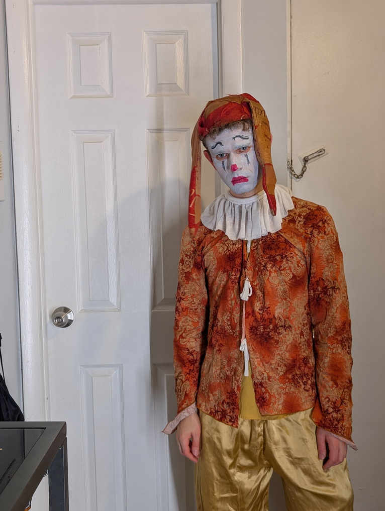

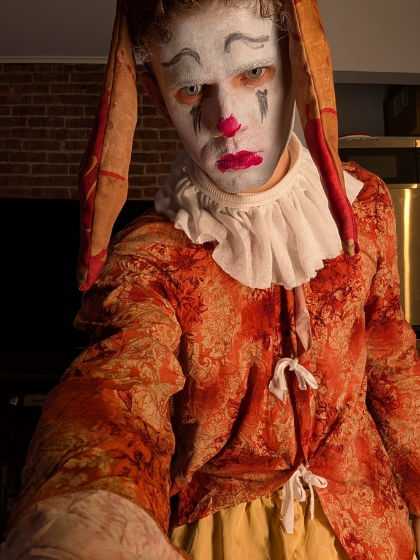

For Halloween this year, I was originally thinking of using the [[Creations/Misc/Halloween Costumes/2025 - Air nomad costume (unused)\|air nomad costume]] I had made last year but never used. But then I had sudden inspiration while in the subway one day: to be a sad clown. It seemed hilarious to me to imagine going to a halloween party with clown makeup on and just acting like a clown. 

The end result was a cross between a jester (with the floopy ear things) and a clown. My first idea was actually to wear a pinstripe vest (which I had from my [[Creations/Misc/Halloween Costumes/2025 - Hades costume\|2025 - Hades costume]] costume last year). But then I had the idea to make it more of a colorful circus theme, which led to the jester-type look. 


### Wearing the costume + Marching in the NYC Halloween parade

It was fun to wear the costume in public! It was a little scarier/sadder than I expected it to be. I got several compliments on the street while I was heading between the subway to the apartment where the Halloween party I was going to was. At the party, pretty much everyone took several seconds to stare at me before recognizing who I was (more an artifact of the clown makeup of course, but still a fun effect that I got a kick out of. Seeing the moment of realization on their face).

I also had a great experience marching in the NYC Village parade. It was a great costume for it. More on the parade experience, but it took about an hour of waiting in the lineup before getting into the actual parade stretch and being able to walk freely. But once I was out there, I kind of sped through relatively fast. I mostly walked along the side, where the spectators were hugging the barriers. I went into performance mode^[I was thinking about where this performance mode came from and where I get the instinct from, because I've never formally performed, but maybe it's just from similar feeling from past Halloween costumes, or just the suppressed improv spirit within me (I've never done improv before)] and sulked on the sideline, walking in a slow trudge, head tilted sideways and downward, letting my face and eyes droop in sadness. 

The reactions made me keep doing this. Many spectators went "oh noooo, so saaaaad" and similar, and I went with it. A couple kids stuck out their hands for a high five and I moved my arms sluggishly while continuing to walk and sometimes delivered the high five but sometimes purposefully not (as though I was too sad/sluggish to follow through). Someone offered a snack sized twizzler and asked "will this make you feel better?" and I slugglishly took it and sadly intoned "mayyybe". There were many people recording or taking pictures with their phones, and I leaned into making myself as sad as possible for them. A highlight was a couple teens standing atop some pole and from afar seeing me and shouting something to me, and I weakly waved to them.

I also tried to make sad eye contact with as many people on the sideline as possible, and it was funny (inside my head) anytime they followed my eyes with theirs and I never broke my expression. There was one funny moment where I couldn't contain my laughter when someone asked "why are you so sad?" and I shrugged, and then they asked, "When is the dance?" and I looked at them dumstruck because I had no clue what/why they were asking me, and it was so absurd that I broke character and cracked up laughing and said "what???" as I continued walking. Their friend grinned at me too, as if also seeing the absurdity.

### Making the costume
It was really fun to make this costume! I feel like I learned a lot. I feel like I was flexing my costume designer skills, and it made me wonder if [[Interests/Theater/Theater\|theater]] costume designer was a career path that some alternate-universe version of myself could pursue. In this universe, I think it's likely to stay a hobby. But who knows what the future holds. (Actually though, given that I have a nascent interest in [[Interests/Theater/Getting involved in theater\|getting involved in theater]] again some day, maybe costume design could be a subskill or something I could help out with if needed. Of course I'm still pretty much a beginner at sewing, but I guess I've developed some fundamentals that could be grown on.)

#### AI for visualization assistance
I had ChatGPT mock me up a visualization of what the costume might look like. Retrospectively, I feel conflicted about whether I should have done research on my own of what historical jester garb looked like, rather than just having ChatGPT generate an image for me. Part of me feels like the look that I ended up with is a direct result of what AI gave me and I just went with it. It maybe feels like there is a missing step in the creative process there - I outsourced the visual inspiration. But then again, how different is this from looking up reference images or copying some similar outfit I see on the internet? How "original" did I "have" to be? Probably what matters is that I am happy in the look in the end. And I made a lot of creative decisions on my own when it came to actually selecting the materials and putting them together.

I want to give some demonstration of how I used AI image generation to assist with the costume. The earliest mockup was after I described the basic look I wanted.

My prompt: 
```
I want to look like a depressed sad clown who was in the circus but is sad. Dark melancholy vibe. Want one of those flooopy jester hats. Would like to have kind of a dirty down in the dumps look. Dirty muffled circus colors.
/
Gen 3 images of my potential costume slifhtly diff styles each
```

Example of one of the output images:
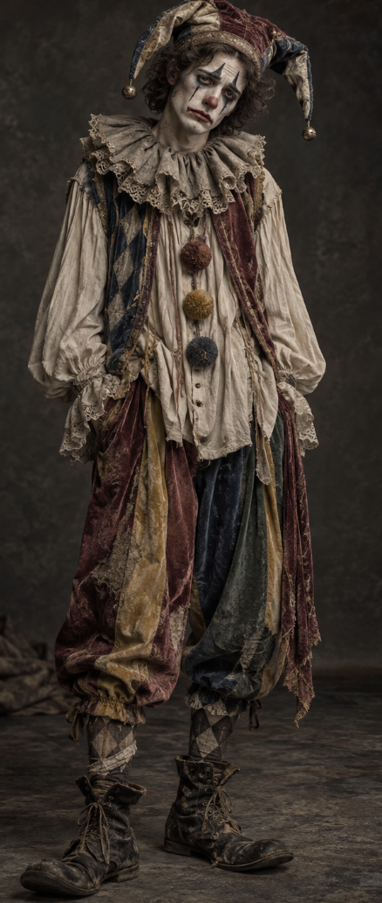

This helped me visualize what the costume could look like.

##### Serendipitous acquisition
Then, I was at a thrift store and I found a couple items that I felt could be perfect for the costume. I took pictures of the items on the spot and asked ChatGPT to help me visualize what the costume could look like with these specific pieces. I also gave it the photo of me from when I originally tested out the clown makeup, so it was able to overlay my own clown face onto the proposed costume.

My input images:

| 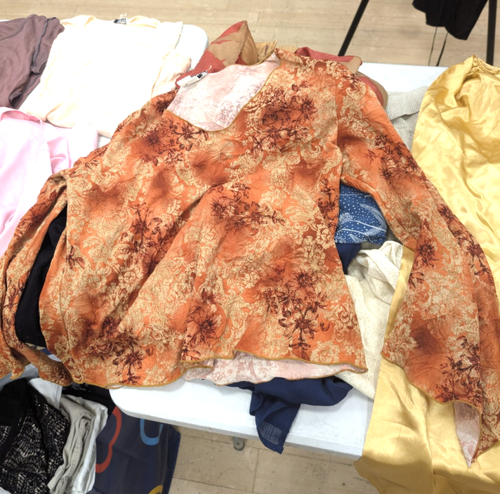 | 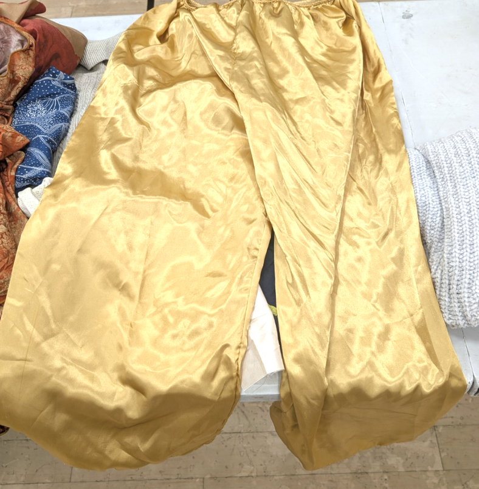 | 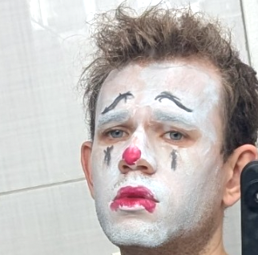 |
| ------------------------------------ | ------------------------------------ | ------------------------------------ |

Generated:
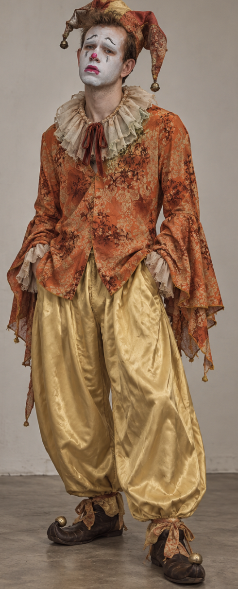

That was all the AI image generation I used for this project. The rest of my AI usage was text chat, to help walk me through the sewing part (mostly guidance on making the hat and ruffle collar).

I also got two more items from the thrift store that were *instrumental* in the creation of the full costume:

This colorful banner which went perfectly with the shirt:

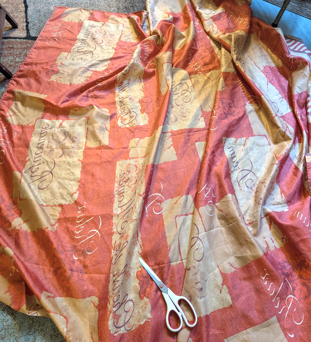

And this thin white blouse that I was hoping to be able to use for the ruffle collar:

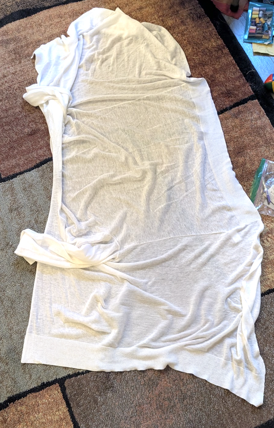

Side note -- for the clown face, I used three products: cream water-based face paint, an eyeliner pencil for the drawn eyebrows and tear drops, and red lip cream for the mouth and nose.

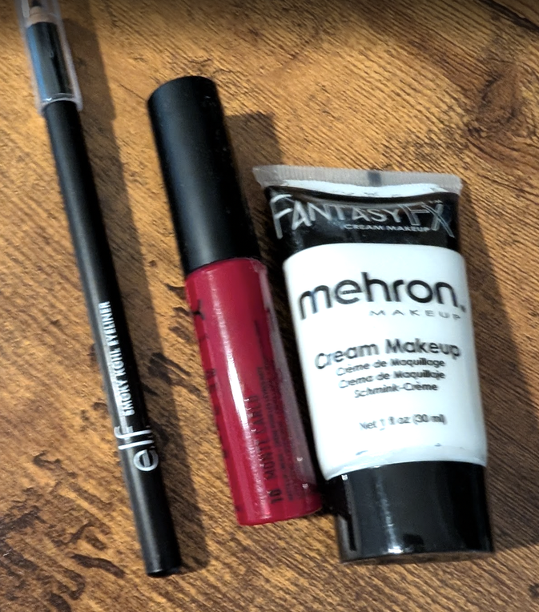


#### Making the hat
This was the most advanced sewing project I've done. In the past, I've done some basic tailoring of shirts to take in the seams so they could fit me better. I've also done a couple other minor repairs and also did a little bit of sewing for my lettuce costume two years ago (which included resizing a vest to fit me better, and sewing on a small square patch). Those were all using a sewing machine. For this project, I used both a sewing machine, *and* I did hand stitching -- the first time I've ever sewn by hand.

The first part I worked on was the hat. I started with a baseball cap and used a seam ripper to take the front rim off.

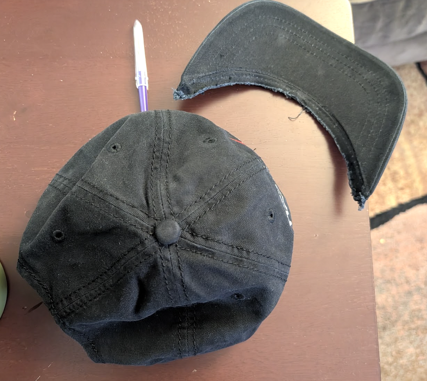

Then I cut a large square from the banner and folded it around the hat, pinned it in place, and sewed it on.

| 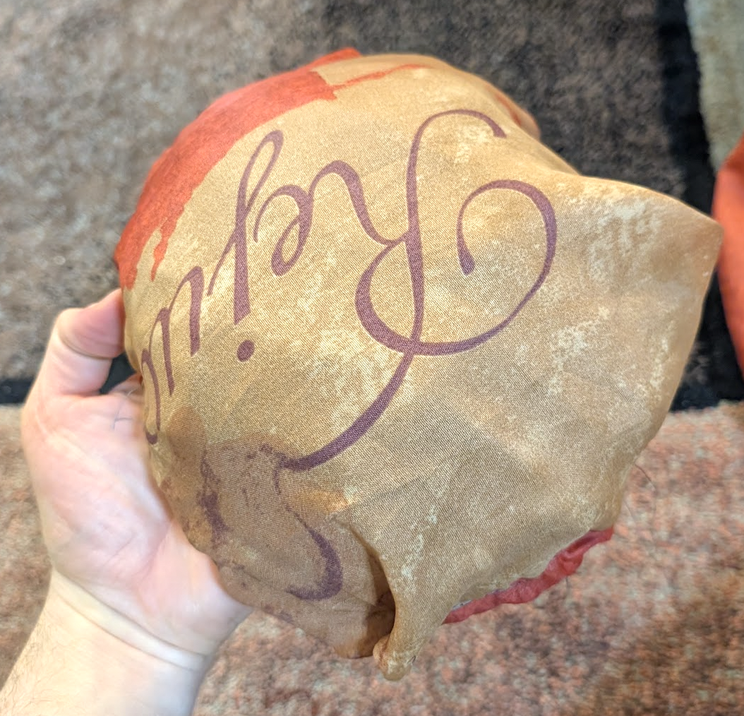 | 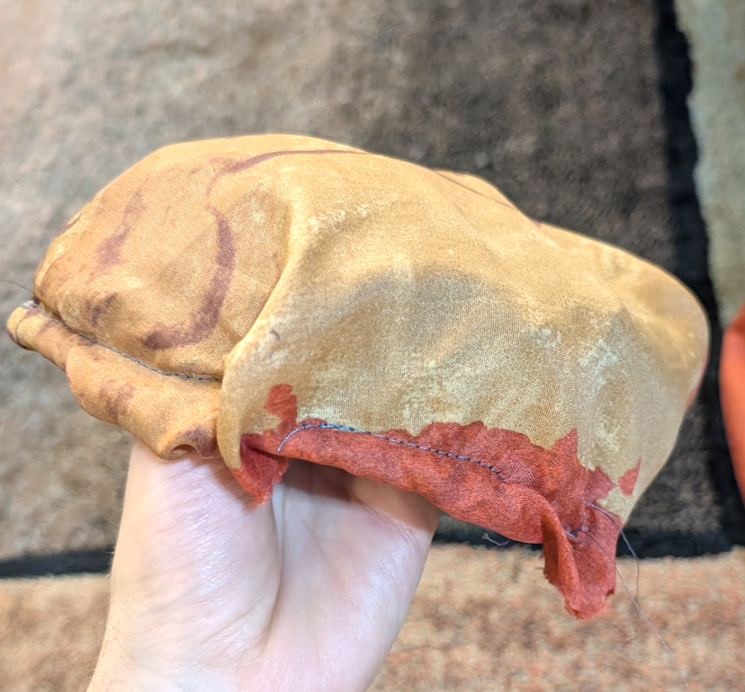 |
| ------------------------------------ | ------------------------------------ |

Then for the floppy horns^[in my head these are the "floopy ear things"], I wasn't sure how best to construct them. I was both asking ChatGPT for advice and also looking up images of jester hats online to try to figure out what stitching pattern they used. I feel like working this part out is connected to my interest in [[Interests/Creative/Misc/Plushie making\|plushie-making]], though ultimately the horns ended up being pretty simple to make (though it took some thinking to plan out). 

I ended up doing a simple two-sided triangle, with a modest amount of scrap fabric stuffed inside to give it a little depth (more attention to the stuffing would perhaps have led to something more like the original hat mockups, but I felt satisfied enough with the full downward floop that I just left it. I think it helped add to the "sad" effect).

The procedure was to cut two triangles out of the banner:

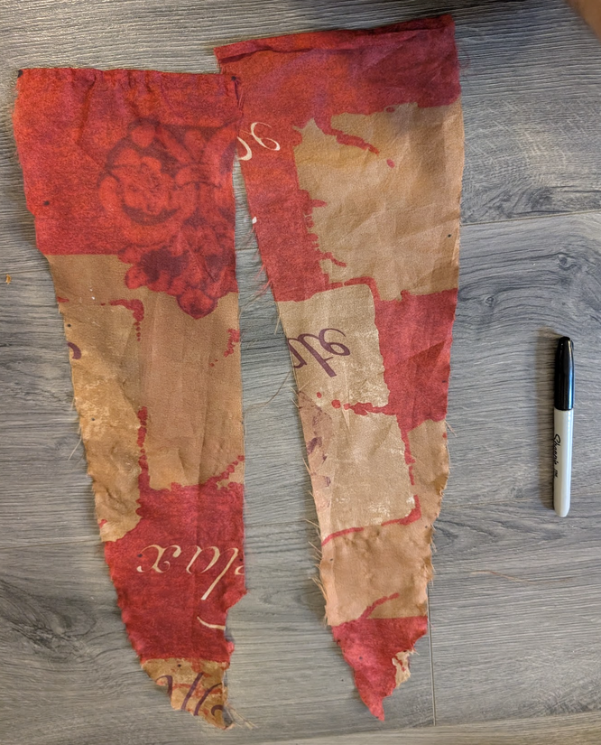

Then sew their sides together (but not the bottom):

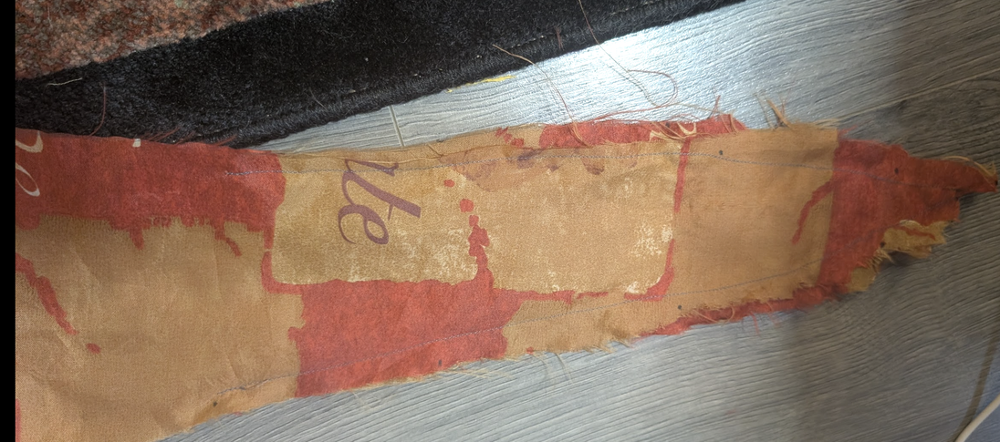

Then finally fold it inside-out to hide the stitches (I feel like this is a magical part of plushie-making which I never would have realized without looking up the basics of plushie-making).

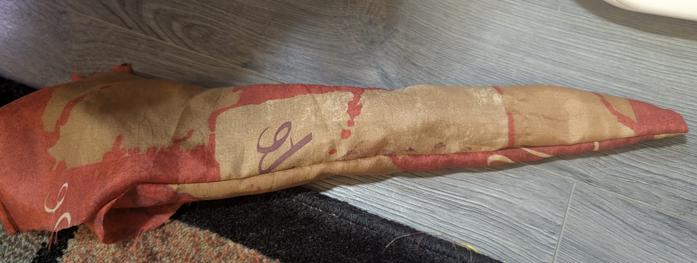

It's kind of hard to show this part in the photo, but I then stitched the horns (I made a second one just like the above) onto the base cap. It was important to leave extra unsewn material at the base of the horn so that I had extra fabric to blend in with the top of the cap. I hand-sewed this part since I thought it would be too awkward to get the thick hat material into the sewing machine sewing area. This was my first time hand-sewing! I had to watch a couple videos and it was satisfying to make my first stitches on a test scrap before applying it to the real thing. It was slow and a little tedious, but also kind of meditative, and I enjoyed it.

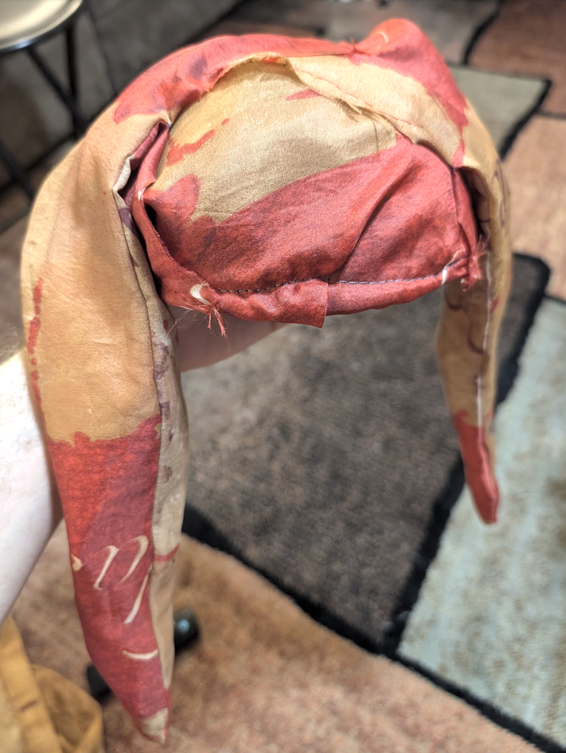

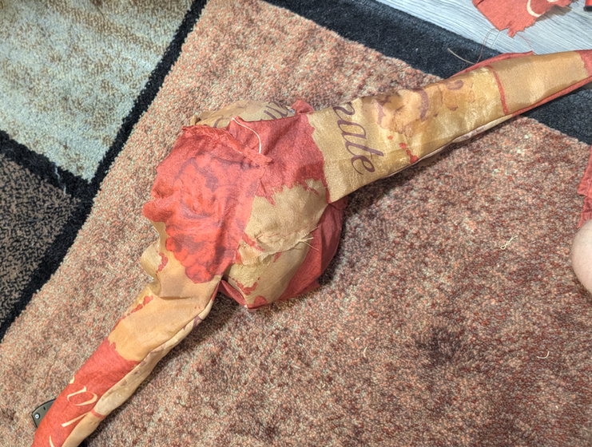

I also ended up adding a small baby horn (my first mini test run of the process) to the back of the hat to balance it out a little. This isn't visible in the most of the pictures I took of myself, but I have to assume that people standing behind me while I was wearing the costume formed some judgement or perception of this part of the costume... whatever that judgement is, I do not know.

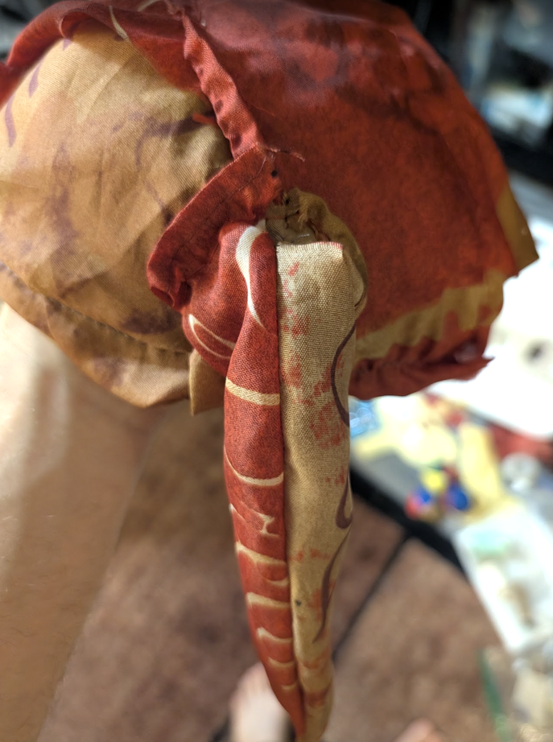

Overall, I was really happy with how the hat came out! And it was instrumental to the final look. When I put on the full outfit for the first time (including makeup), putting the hat on changed everything and brought the whole thing together. I literally was having doubts about the costume, not sure if it looked right / how I was imagining it, and then I basically gasped / jaw-dropped when I put on the hat and was stunned at how much it transformed me into the sad jester/clown I was aiming to be.

#### Making the ruffle collar.
This was the other really interesting part to sew. I followed a combination of ChatGPT's instructions and a couple things online.

The way you do it is by cutting a long strip of fabric. Then, sew a line of wide stitches at one end of the fabric, without backstitching (so that the threads are still loose and not tied off at the ends). Then, gently tug on one of the threads (just one side only (out of the top and bottom thread)) and push the material inward so that it ruffles. It's kind of hard to describe, but the material ends up forming the mountains and valleys because of how the thread goes in and out. The first time I tried to do it, I snapped the thread from pulling too hard, and had to pull from the other side (right vs left of the long strip), but then I pulled too hard and the thread fully came out, so I had to re-sew the line on that part of it again. This happened a few times. But eventually I figured it out.

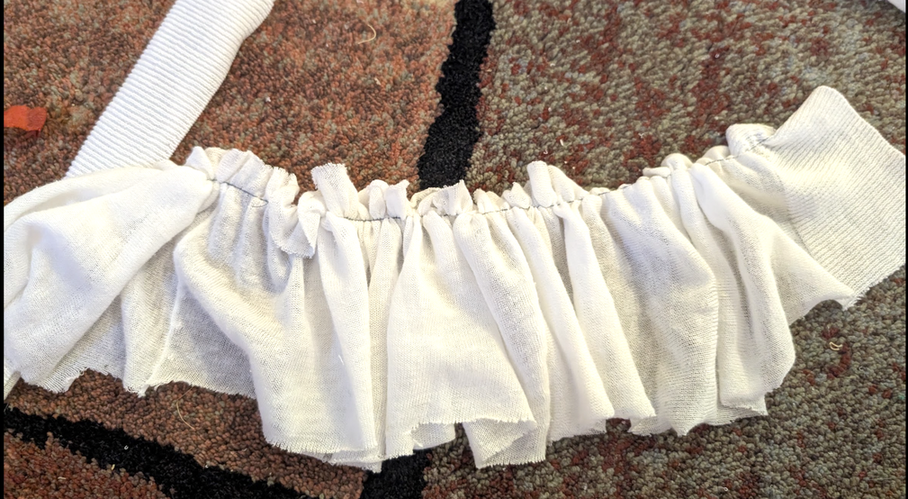

The final step was to create a band out of extra fabric and cover the top part of the ruffles. I kept repeating to myself, *fill the taco*, because ChatGPT had described it like that at one point. Silly, but it was helpful to visualize what the next step was. (The strip of fabric for the band gets folded in half, and then the edges get folded to the center, and then the ruffles part gets placed in the middle of those two sides (like a taco shell), and then it all gets sewed up). 

The extra band material on the sides was also important so that I could tie the collar around my neck when assembling the final costume.

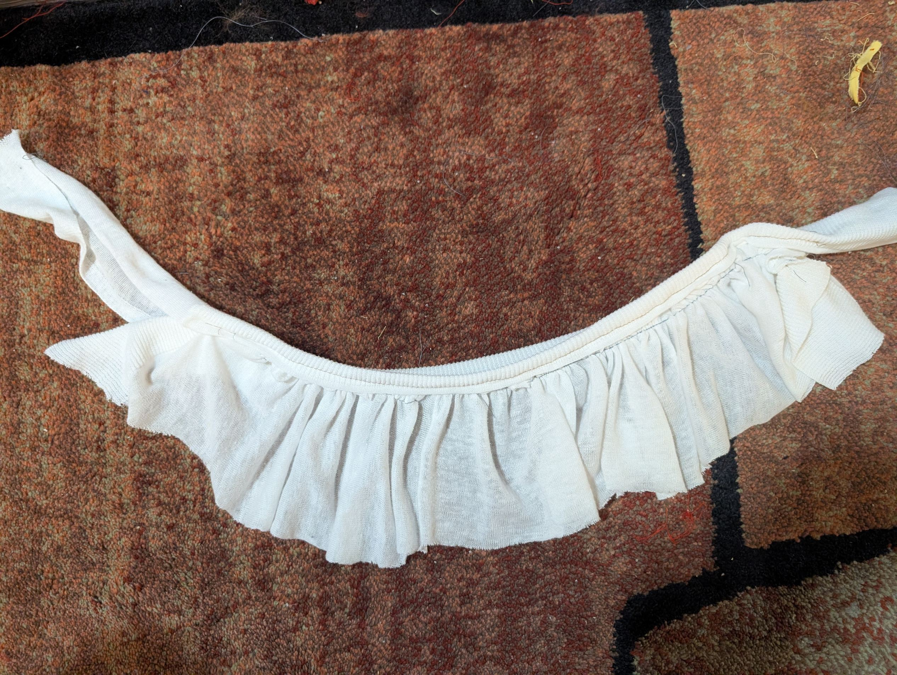


#### Shirt and ties

The last thing I had to do was cut the patterned shirt in half (it originally was a closed shirt, and it looked too much like a woman's top like that, and not like a jester's dress shirt). 

Then I needed to add a clasp or ties of some sort so I could close it up. At first I was thinking of making some kind of acorn clasp (I literally had acorns from the park, which I originally was thinking of adding to the end of the floopy horns as a replacement for jester bells that might dangle, but I never got to doing that). But I wasn't totally sure how the acorn clasp would work and it seemed a little too complex.

So I decided to go with ties (like shoelaces). At first I tried to use the banner material for the ties, but when I made a loop, the bowtie knot became incredibly tight and bonded that I literally could not undo it without resorting to cutting it off. So that was not an option, because I wanted to be able to tie and untie them. I was searching for what I could use, and realized the white blouse material was thick enough that it would tie up better without getting un-undoable. This worked out perfectly. I cut strips, and sewed part of the strip to the underside of the shirt (I first made marks with a sharpie so I would remember where I wanted them to go, when testing in front of the mirror).

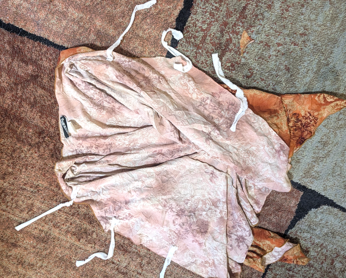


#### Hiding my backpack

The above was everything I did for Day 1 of using this costume. For Day 2 (actual halloween day), I was planning to march in the NYC Village Halloween parade, but I needed to take my backpack. I thought I could just drape the extra banner material over my back like a cape, but when I was getting ready to leave, I realized that it was not really going to work out. So I whipped up a last-minute solution, which I'm kind of proud of myself for doing - it came out well and I was under time pressure because I couldn't be much later to the parade. 

I made two wide strips from the banner which would cover the straps of the backpack that would show on the front of my body. I hand-sewed the material in a tube around the straps (I definitely could not have used the sewing machine here^[(or at least it would have been very awkward... perhaps someone with more experience could, though I still think it wouldn't be ideal)] so I was grateful I had gotten used to hand-sewing at this point). Then I used a bobby pin at the top of each strap to ensure the tube didn't slip down the length of the strap.

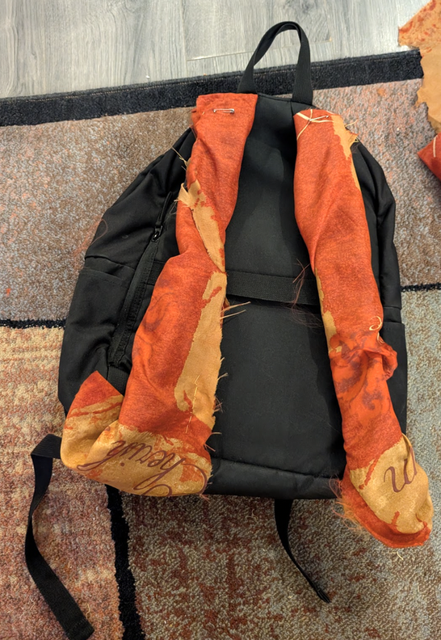

Then I made a large rectangle of banner fabric for the front. I tied the top of the fabric to the loop at the top of the backpack, and then used another bobby pin, one on each side, to attach the fabric around to the back-side of the bag (the part that touches my back, so that the whole side of the bag was covered). It wasn't a super clean job, but it got the job done. 

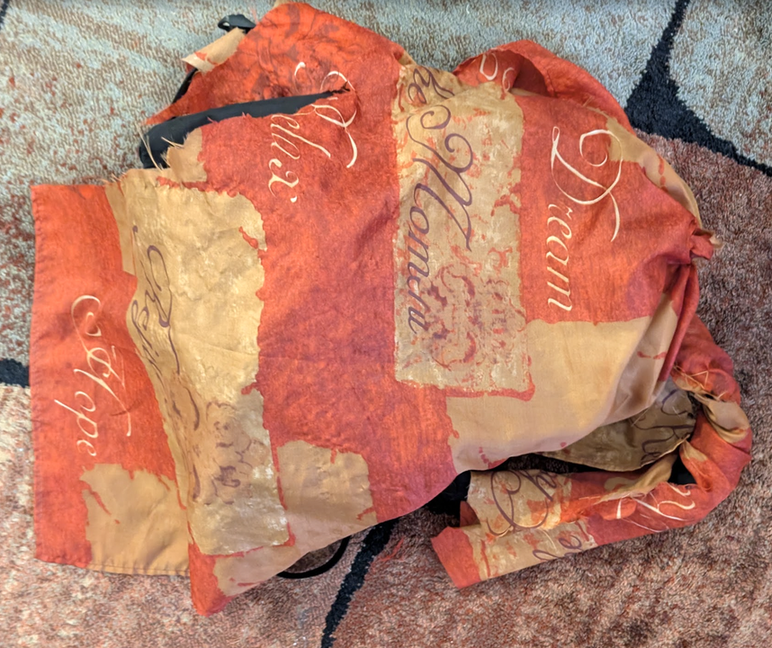

I thought it would look silly to be wearing a backpack, but it actually ended up looking like some kind of knapsack that my clown character was wearing. The front straps also blended in really well with the shirt, and I could hardly tell that they were there!

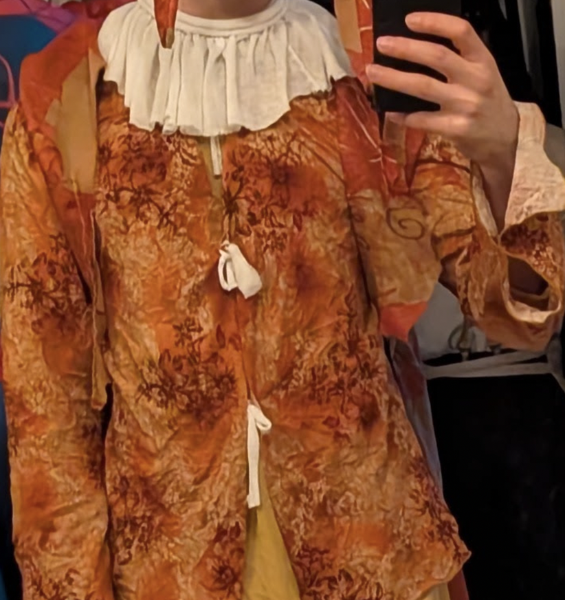

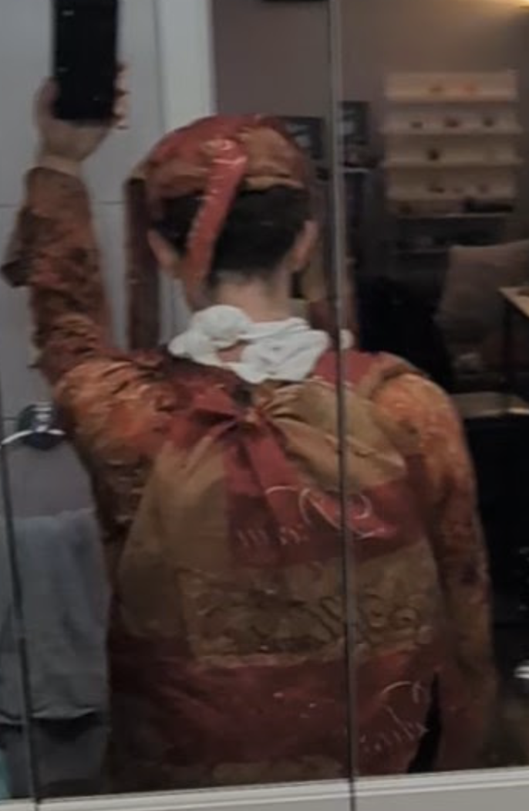


### Conclusion
Again, it was really fun to make and wear the costume.

I have a feeling I will not put as much effort into my costume next year. Something simpler. We'll see though. Definitely something that obscures my face less, because I felt a little bit at the parties I went to that I wanted new people I was meeting to be able to see my real face. But I have no regrets - this Halloween was all about embracing this costume.

