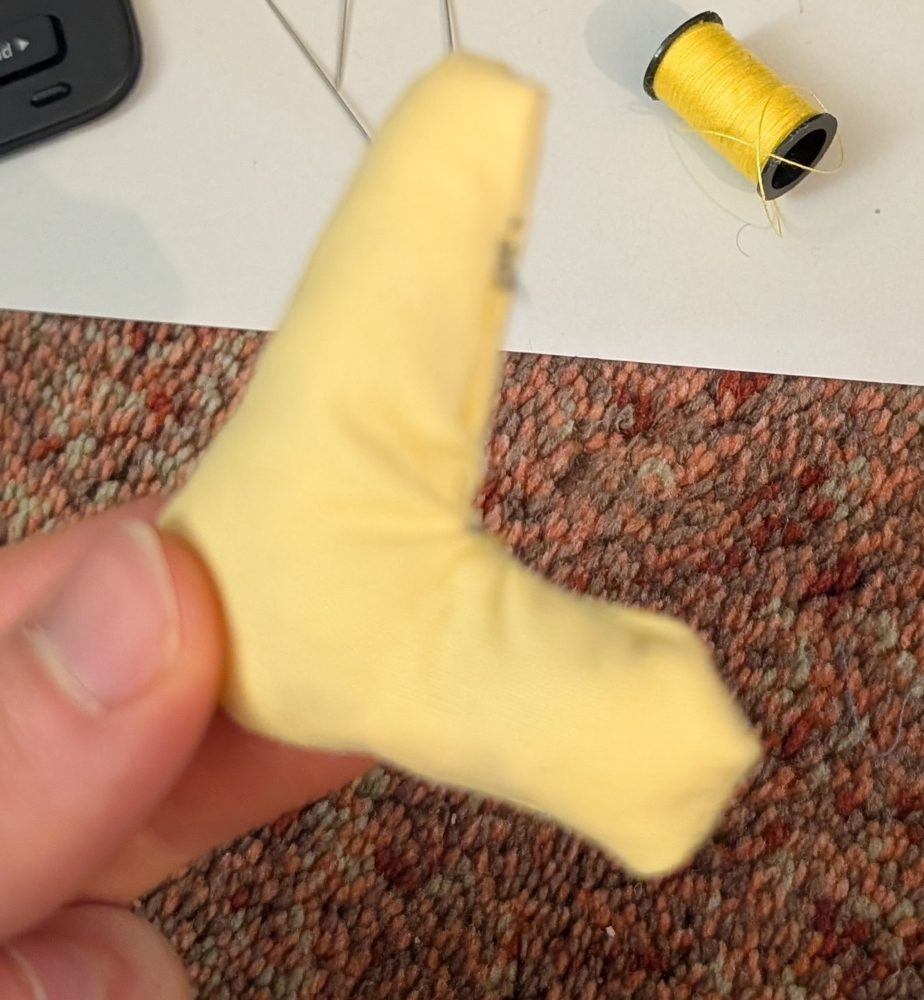
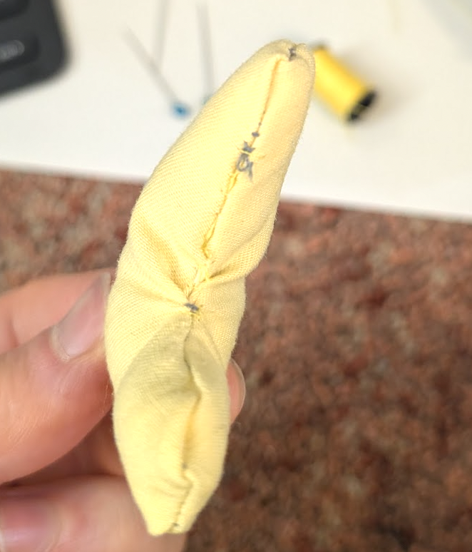

---
{"dg-publish":true,"permalink":"/interests/creative/misc/plushie-making/","dgPassFrontmatter":true}
---

I think it would be cool to make plushies / stuffed animals of characters. 

Multiple people have suggested crocheting, which seems cool also, but I'm really looking to make something that looks like what you could buy in a store or win at an amusement park darts game or get out of a claw machine^[maybe I am just yearning because I never won those...].

So far my only progress on this skill is that I made an L, using scrap material from my [[Creations/Misc/Halloween Costumes/2025 - Air nomad costume (unused)\|air nomad costume]] in November 2025:

This tiny bit of experience was slightly helpful also when I was working on the horns for my [[Creations/Misc/Halloween Costumes/2026 - Sad Clown costume\|2026 sad clown costume]].

