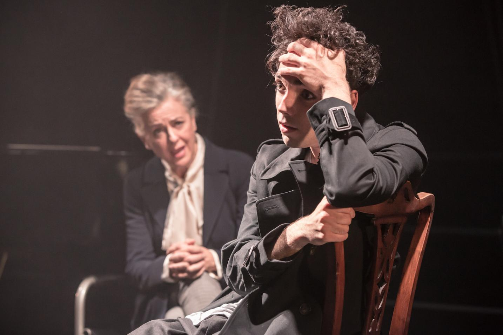

---
{"dg-publish":true,"permalink":"/media-i-have-consumed/theater/preludes-dave-malloy-2015/","dgPassFrontmatter":true}
---

^[([Image source](https://theartsdesk.com/theatre/preludes-southwark-playhouse-review-journeying-mind-rachmaninoff))]

I watched the 2021 proshot recorded at the Southwark Playhouse (off-West End).

Preludes is a "fantasia" musical set in the mind of Sergei Rachmaninoff while undergoing hypnotherapy in order to help him resolve his writer's block.

I am a fan of Dave Malloy (also made [[Media I Have Consumed/Theater/Natasha, Pierre, and the Great Comet of 1812\|Great Comet]] and [[Media I Have Consumed/Theater/Ghost Quartet - Dave Malloy (2014)\|Ghost Quartet]]) and also have significant interest in [[Interests/Misc/Hypnosis\|hypnosis]], so I was excited to watch this musical.

Overall, I was pretty happy with the narrative, emotional journey, and the take on hypnosis. The hypnosis aspect felt quite accurate to what I know about it and about hypnotherapy. The emotional journey has left a lingering melancholy in my mind which I'm sure I will be contemplating for days. I think it was a splendid piece of work and the experience of watching it has standalone merit, even though I don't see myself listening to any of the songs again. There were a couple moments when I was a little bored but it was the minority, and it could have been due to my own state of mind in the moment. The piece is definitely more of a weird and abstract musical, and not an ordinary Broadway musical experience -- which is part of what I love about Dave Malloy's works. If I'm comparing works, I'd say that it's not as strong as Ghost Quartet, but it has more similar of a vibe to Ghost Quartet than to Great Comet (which is a more traditional Broadway piece, which I would categorize his Black Swan under).

I'm also realizing that the recording I watched is a later rendition. The show was on Off-Broadway in 2015 and this proshot was from 2021. I'm curious what the differences are. The proshot was definitely not staged like a normal show, but instead more of a made-for-streaming type thing. I am curious what actual staging would look like.

**Below the spoiler warning, I'm including some notes I took while watching the show, and perhaps some analysis of the plot. Only continue if you've seen the show or don't care about being spoiled.**

>[!DANGER] Spoilers ahead.
>>[!DANGER] Spoilers ahead.
>>>[!DANGER] Spoilers ahead.
>>>>[!DANGER] Spoilers ahead.
>>>>>[!DANGER] Spoilers ahead.

>[!DANGER] Spoilers ahead.
>>[!DANGER] Spoilers ahead.
>>>[!DANGER] Spoilers ahead.
>>>>[!DANGER] Spoilers ahead.
>>>>>[!DANGER] Spoilers ahead.

Notes I took while watching

(just putting this here for now, hopefully will make this more coherent later. TODO.)

- pre talk
- list of interests (~20:00)
- letter from tolstoy
- 30:00 get quote - im happy when i finish something and know it's good
- i am not my body/mind song
- 1:10 what if that was mybest one
- 1:23 do you ever try to write happy music? I dont try anything. This is just what happens. 
- cousin love/relationship like war and peace 
- czar w southern accent is absurd