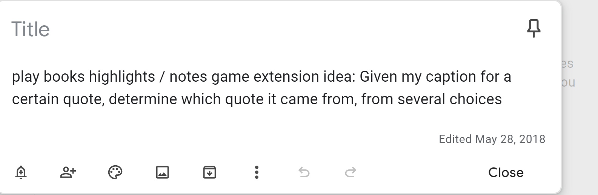
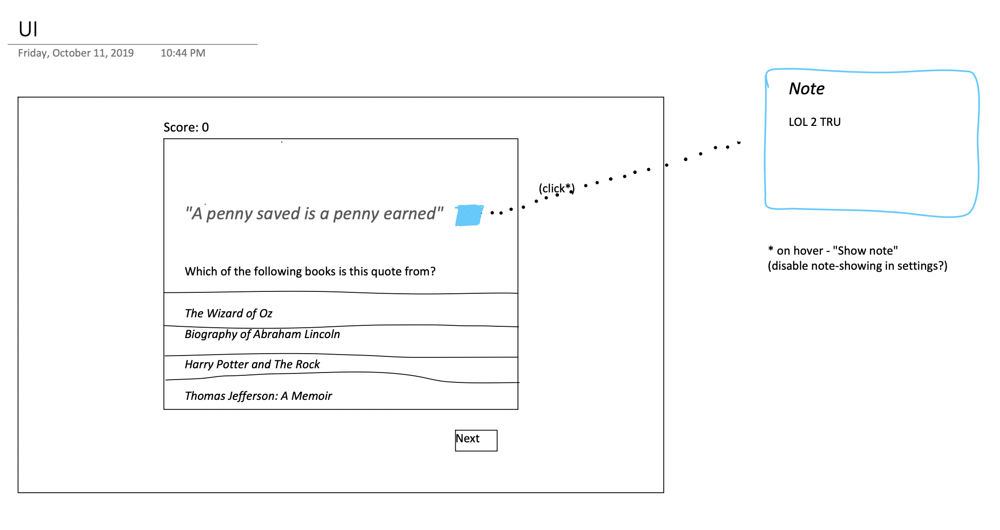
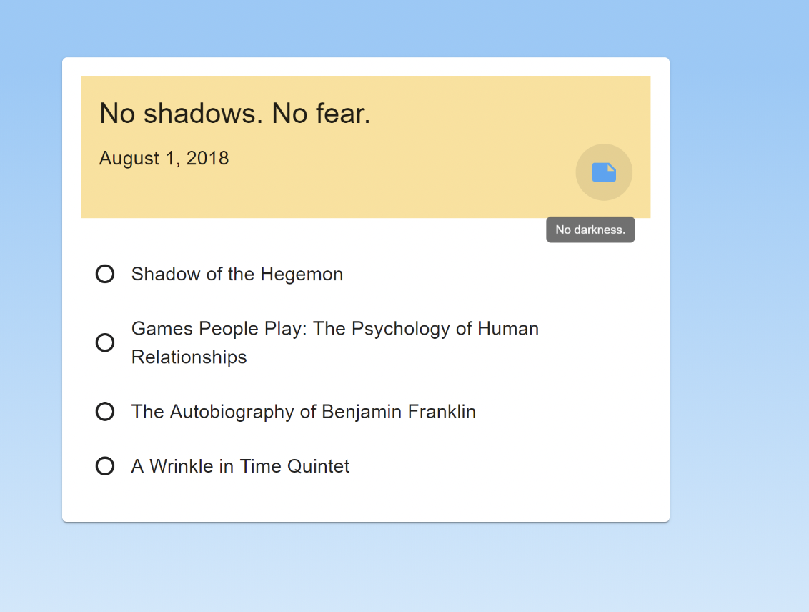
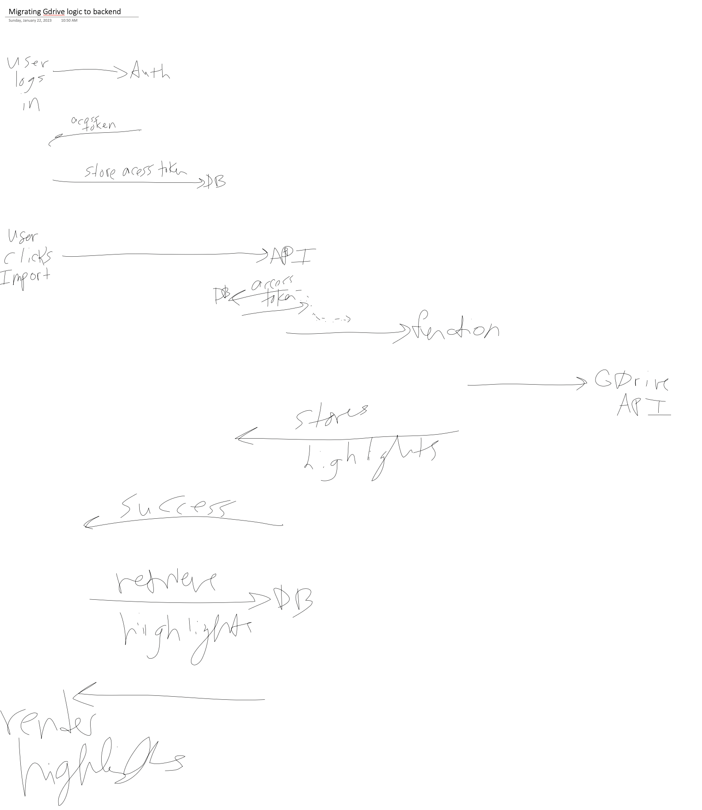
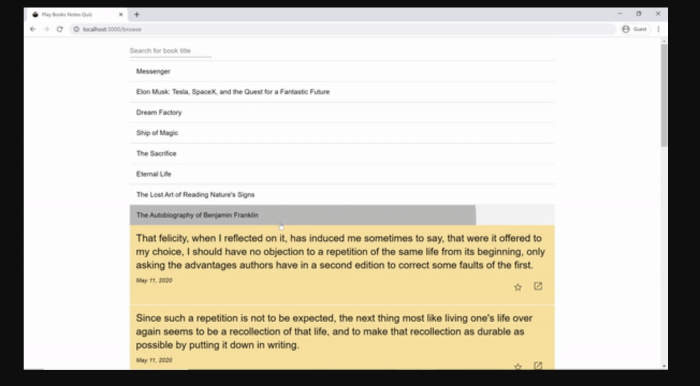
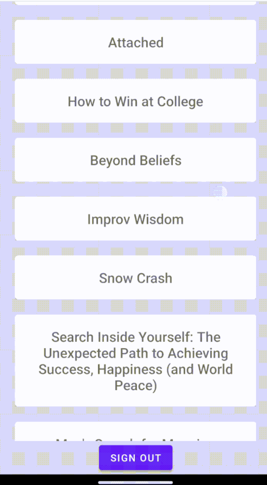
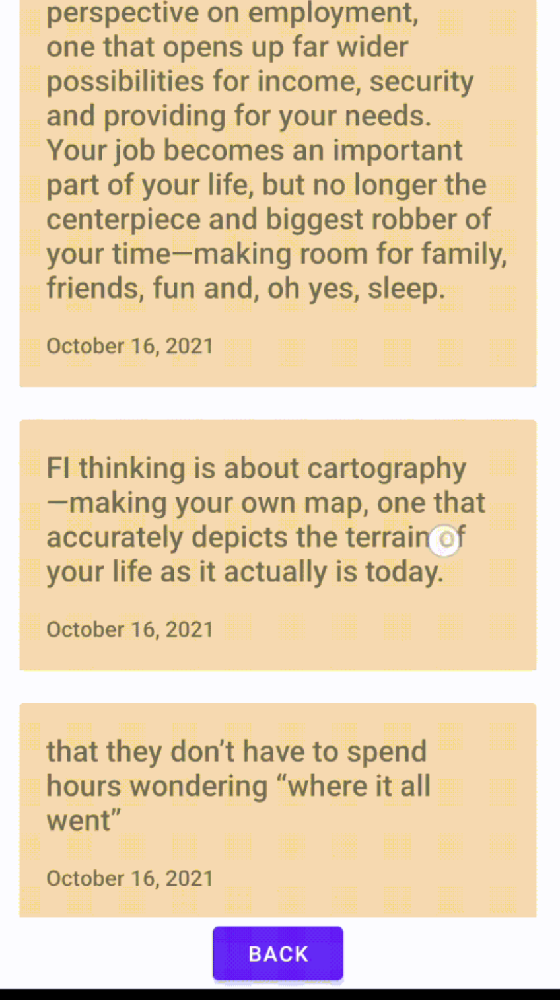
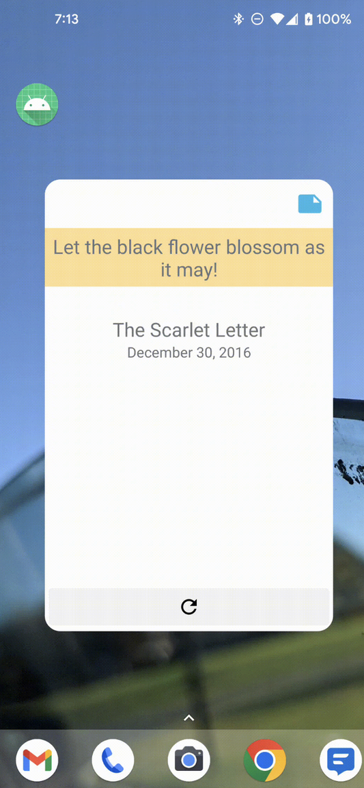

---
{"dg-publish":true,"permalink":"/projects/software/play-books-notes-quiz-and-browser/","dgPassFrontmatter":true}
---

#### How it started
I've used Google Play Books as my e-book reader of choice for a long time (starting in high school).

I also am a semi-frequent highlighter when reading a book. If there's a quote that stands out to me in some way -- whether it's sage life advice, or just something I find funny -- I'll highlight it. I even have a sort of loose [[Interests/Reading/Book Highlights Color Code\|color code]] for how I highlight.

In 2018 (when I was 17 years old), I wrote this idea into Google Keep:

^[play books highlights / notes game extension idea: Given my caption for a certain quote, determine which quote it came from, from several choices]

#### Turning idea into reality - making the quiz
That note sat there for over a year, until in October of 2019 I started working on the idea. This became the basis of what I was calling the "Play Books Highlights Quiz". 

Actually, the idea wasn't quite what the Keep note said. Instead of presenting myself with my written annotation about a quote and making myself determine which quote it came from, it presented one of the quotes I highlighted and I had to pick which book title it came from.

The idea was that this would be a way for me to look back at my highlighted passages (to perhaps remind myself of whatever reason I highlighted it for), in the form of a fun little game.

My mockup (sketched in OneNote) of the idea:

And the actual result:

I was pretty happy with the result. To be honest, though, I never really actually used it much. The quiz was fun enough when I was playing it, but it was a bit gimicky. I was more just proud that I had created this thing and taken it from mental vision to reality.

Technical side note -- The extraction of the quotes from Google Play Books was made possible by a quirk of the platform -- there is an option in Play Books to auto-save highlights to a Google Doc, one per book. So I built into my webapp the capability to select those files from my Google Drive, and then parse the Google Doc to extract the quotes (including the highlight color, book title, date highlighted, and link to the exact location of the quote in the ebook).

#### The next step - building the browser
The project sat for a couple years. But it was simmering in the back of my mind, and I knew I wanted to do something more with it.

Admittedly, the quiz idea was kind of a gimick. Fun, but a gimick. I sensed something more important to me emerging: being able to browse my highlights in a nicer way than Play Books natively allowed me to. And I had all the data - I just had to implement it.

I took the next steps throughout 2022 and 2023. The first thing I needed to address was the reliability of the quotes storage. In the initial project, I was loading the quotes on the frontend client only. The browser was doing all the work - downloading the files from Google Drive, parsing them, and storing them in the browser's local storage. The last bit is important -- it means that if I somehow cleared my browser cache or needed to switch computers or something, I would have to re-import all my quotes again^[which admittedly wouldn't have been too big of a deal, but it would happen occasionally and it was an annoyance]. 

So I decided to create a backend for the webapp. I used Google Firebase, which made it easy to set up authentication, backend cloud functions with an API, and a realtime database. 

A sketch I found in my notes where I was mapping out how to pass around auth so the backend could pull the required files from Google Drive on behalf of the user token which the Oauth picker provided from the frontend:

Once I made that architectural change, it felt reliable enough for me to build the next part that I cared about -- the browser.

It listed all the books in my library, and showed me all my highlighted quotes (and any of my written annotations on the highlights) for each book.

I was pretty happy!

#### The lasting impact -- Android app version and widget
Again, I have to be honest. I haven't touched the webapp version of this since I finished working on it in 2023.

But the next iteration is the one that stuck. 

Pretty soon after finishing the browser, I decided to make an Android version of it. I knew even then that this would probably be the version of this that I would keep using.

|  |  |
| ------------------------------------ | ------------------------------------ |

Then I had the idea for the most lasting feature -- the widget.

I wanted to have a widget on my phone's homescreen that would show me a random quote from my highlights, and auto-refresh daily. I had this working by July 2023:

Another thing to note is that it also periodically re-imported new book highlights from Google Drive, so I didn't have to manually do anything for new books that I read. Over the last several years, I have been occasionally surprised that this flow has not broken - I haven't had to touch the code for over two years.

Needless to say, I've had this widget on my homescreen ever since I created it, and I genuinely enjoy having it there. I like to ocassionally look at what highlight it is showing, and get a kick out of the quotes or my associated note. 

All the code for the webapp and Android app are available on my Github^[It crosses my mind that, since I may want to eventually monetize the app I'm releasing in some way, that I should make it harder to access this code. But frankly, my code is nothing revolutionary, and someone could easily reproduce it just with an AI coding tool. if someone is paying me for this, it is for the convenience of my having made the app for them, not out of the impossibility of them implementing it themself.]:
https://github.com/briancherin/Google-Play-Books-Highlights-Quiz
https://github.com/briancherin/Google-Play-Books-Highlights-Android-Widget

#### Why did I never put this out anywhere?
Well, it worked for me, but it didn't feel stable enough for real users. I tried to have a couple people use the Oauth flow on the webapp version and it didn't work, and I never looked further into it. Plus, I was mostly content with using it for myself. It also partly was a nice side project to be able to have on my resume (of course the grand majority of my motivation was to have a tool that I liked using for myself).

#### Jumping to 2026 -- releasing a simplified version
So it's 2026 now. 

For a long time, probably ever since I've started programming, I've wanted to publish apps that people actually use, and hopefully one day make money from them. I had a little taste of this from a simple Android app that I published while I was in high school which I actually made a couple thousand dollars in ad revenue from. But since then, nothing.

I constantly am thinking of ideas for possible apps/projects. In the last few years, I've tried to sneak in time between all the other things I hold myself to working on in my life to work on coding projects, but they never have really gotten far enough to a place where I'd actually release something. I have felt very motivated by ideas like [[Projects/Software/Grocery Receipt Tracker\|Grocery Receipt Tracker]],  [[Projects/Software/Idea - Spontaneous Plans/Idea - Spontaneous Plans\|Idea - Spontaneous Plans]], and [[Projects/Software/Idea - Social ebook annotation\|Idea - Social ebook annotation]]. But I never got anywhere, for one reason or another.

I think part of the lack of going anywhere was because I was biting off huge projects which had a lot of uncertainty on whether I could do them well or reasonably get usership. 

Recently I have been thinking more about putting out something *smaller* and straightforward.

I was laying in bed one night, thinking about what simple thing I could put out, when the obvious struck me -- my Play Books browser.

It's not a revolutionary product. And it's very niche -- for people who use Google Play Books and like to highlight things, and feel the need to browse those highlights separate from the official app. And also who are Android users, because I don't want to invest the time to translate this to iOS yet^[maybe I will if I get a better sense of whether people actually want to use this].

But it's *something*, and I really just want to get *something* out there.

But I had to simplify it still. I have realized with these recent projects that it is not cheap to run a backend server, and it's hard to justify an always-available backend when there are no users.

So I didn't want to release a backend-supported version of the highlights app.

Instead, I'm making a local-only version (i.e. pretty similar to what the earlier iteration of the webapp was). The user will import their book files from Google Drive, the app will parse and store them locally, and then the user will be able to browse their notes and add the auto-refreshing widget to their homescreen.

I'm almost ready to release this, and I've already been learning a lot. It feels very different to be publishing an app with an adult mindset, compared to ten years ago when I was publishing fun-facts apps under a pseudonym. I'm feeling the momentum build, and it's already leading me into the next bite-sized project I want to release - [[Projects/Software/Photo Prompt Journal\|Photo Prompt Journal]].

Again, I'm keeping my expectations low. I don't expect many users. But I'm curious to see what will happen. It's kind of crazy that I'm finally doing something with this project that started as an idea in my mind over eight years ago.
